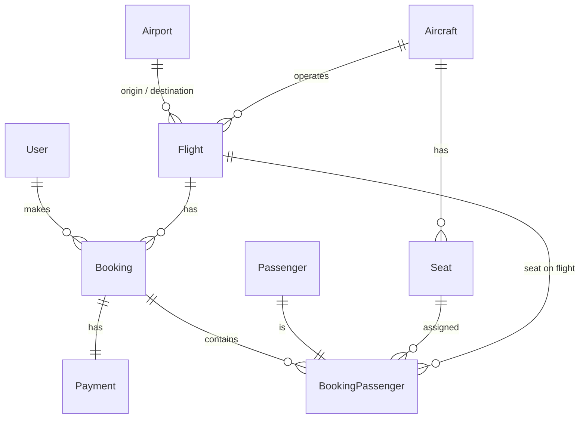

# Flight Booking Management System

A full-stack school project: customers search flights, pick seats, enter passenger details and book; administrators manage airports, aircraft, flights, bookings, passengers and customers.

**Stack:** Next.js (App Router, TypeScript, Tailwind, shadcn/ui, React Hook Form + Zod) · Django + Django REST Framework + JWT · MySQL 8 · Docker Compose

## Business problem
Airlines must sell each seat exactly once, price tickets consistently and let staff track bookings and payments. This system models that: availability is calculated per flight and cabin, prices are always computed by the backend, and a seat can never be double-booked (transaction + row lock + database unique constraint).

## Features
- **Customer:** register/login (JWT), profile, flight search (origin, destination, date, passengers, cabin), results with filters, flight details, interactive seat map, passenger forms, review, booking reference, My Bookings (Upcoming / Completed / Cancelled), cancellation.
- **Admin:** custom dashboard (stats, recent bookings, upcoming flights, status overview); CRUD/status for airports, aircraft (with seat map and seat activation), flights; booking confirm / cancel / mark paid; passenger and customer views.
- **Business rules:** origin ≠ destination, arrival > departure, aircraft must be ACTIVE, prices > 0; cancelled/departed flights not bookable; seat must exist on the aircraft, be active, be in the chosen cabin and be free; one seat per passenger; status workflow `PENDING → CONFIRMED → COMPLETED`, `PENDING/CONFIRMED → CANCELLED` (terminal states are final); price snapshot stored on each booking; cancelling releases seats and refunds a paid payment; cancelling a flight cancels its bookings.
- Simulated payments only (CARD / CASH / PAY_LATER; UNPAID / PAID / REFUNDED).

## User roles
| Role | Can do |
|---|---|
| CUSTOMER | register, login, profile, search, book, see/cancel **own** bookings |
| ADMIN | everything above + all `/api/*` management endpoints and `/admin/*` pages |

Permissions are enforced by Django (`common/permissions.py`, per-view querysets); the frontend only hides links. Public registration always creates a CUSTOMER.

## Quick start
```bash
git clone <repository>
cd flight-booking-management
cp .env.example .env
docker compose up --build
```
Open:
- Frontend: http://localhost:3000
- API: http://localhost:8000/api/ · Django admin: http://localhost:8000/admin/
- MySQL: localhost:3306 (inside Docker: `db:3306`)

On start the backend waits for the MySQL health check, applies existing migrations, loads demo data when the database is empty (`AUTO_SEED=true`), and starts Django. Source folders are bind-mounted: Django auto-reloads and Next.js hot-reloads without rebuilding. MySQL data lives in the `mysql_data` volume.

## Demo accounts
| Role | Email | Password |
|---|---|---|
| Admin | `admin@flight.local` | `Admin123!` |
| Customer | `customer@flight.local` | `Customer123!` |

(Four more customers are seeded, all with `Customer123!`.)

## Demo walk-through
1. Register (or log in as the customer) → search **Phnom Penh → Bangkok** one week from today (seed flight **G7-101**, 08:00) → **Select** → choose Economy seat **10A** (left free by the seed) → passenger details → review ($95 + 10% tax = $104.50) → **Confirm Booking** → reference such as `FB-20261013-009` → My Bookings.
2. Log in as admin → Dashboard → Bookings → View (passenger, flight, seat) → Confirm → Mark paid.
3. Reload the customer's My Bookings: status Confirmed, payment Paid.

## Environment variables (`.env.example`)
`MYSQL_DATABASE, MYSQL_USER, MYSQL_PASSWORD, MYSQL_ROOT_PASSWORD, DB_HOST=db, DB_PORT=3306, DJANGO_SECRET_KEY, DJANGO_DEBUG, DJANGO_ALLOWED_HOSTS, CORS_ALLOWED_ORIGINS, TIME_ZONE, BOOKING_TAX_RATE, AUTO_SEED, NEXT_PUBLIC_API_URL`. Never commit `.env`.

## Migrations
Migrations are committed; startup only runs `migrate` (it never creates migrations).
```bash
docker compose exec backend python manage.py makemigrations
docker compose exec backend python manage.py migrate
```

## Seed data
```bash
docker compose exec backend python manage.py seed_data          # skipped if data exists
docker compose exec backend python manage.py seed_data --reset  # wipe and rebuild
```
Creates 1 admin, 5 customers, 9 airports (NRT inactive), 4 aircraft with seats (one in maintenance), 12 flights (every status), 8 bookings with 11 passengers and payments in different statuses.

## Architecture
```
Browser ── Next.js :3000 ──(axios, JWT)──> Django REST :8000 ──> MySQL :3306
```
Backend: `apps/<app>/{models,serializers,views,urls,permissions,services,filters}.py`; booking, seat and price logic lives in `services.py`. All responses use one envelope: `{success, message, data}` / `{success:false, message, errors}`.

Frontend: pages in `app/`, API calls only in `services/`, shared UI in `components/`, auth and booking-draft state in `features/`.

## Database / ERD

**Double-booking protection:** `create_booking` runs in a transaction, locks the flight row (`SELECT … FOR UPDATE`), re-checks every seat, and `BookingPassenger` has `UNIQUE(flight, seat, active_lock)`. `active_lock` is `1` while a booking is active and `NULL` once cancelled (NULLs never collide in a unique index), which emulates a partial unique index on MySQL. The loser receives HTTP 409: *"Seat 10A is no longer available. Please select another seat."*

## API overview
| Area | Endpoints |
|---|---|
| Auth | `POST /api/auth/register/ login/ refresh/`, `GET/PUT /api/auth/profile/` |
| Airports | `GET/POST /api/airports/`, `GET/PUT/PATCH/DELETE /api/airports/{id}/` (public read = active only) |
| Aircraft (admin) | `GET/POST /api/aircraft/`, `GET/PUT/PATCH /api/aircraft/{id}/`, `GET /api/aircraft/{id}/seats/`, `PATCH /api/aircraft/seats/{id}/` |
| Flights | `GET /api/flights/`, `GET /api/flights/search/`, `GET /api/flights/{id}/`, `GET /api/flights/{id}/seats/`, admin `POST`, `PUT`, `PATCH /api/flights/{id}/status/` |
| Bookings | `POST /api/bookings/`, `GET /api/bookings/my-bookings/`, `GET /api/bookings/{id}/`, `PATCH …/cancel/`; admin `GET /api/bookings/`, `PATCH …/confirm/`, `…/complete/` |
| Payments | `GET /api/payments/{id}/`, admin `PATCH /api/payments/{id}/mark-paid/` |
| Admin | `GET /api/dashboard/stats/`, `/api/passengers/`, `/api/customers/` |

Search example: `GET /api/flights/search/?origin=PNH&destination=BKK&date=2026-10-20&passengers=2&cabin_class=ECONOMY`.

## Project structure
```
backend/  apps/{accounts,airports,aircraft,flights,bookings,payments}  config/  common/
frontend/ app/{(public),(auth),booking,admin}  components/  features/  hooks/  lib/  services/  types/
docker-compose.yml  .env.example  README.md
```

## Testing
```bash
docker compose exec backend python manage.py test
```
47 tests cover registration/login, customer vs admin permissions, flight validation, availability and search, seat rules (available / reserved / inactive / wrong cabin), booking creation and references, pricing (`$95 × 2 + 10% = $209`), cancellation, status transitions and the double-booking scenario. (Outside Docker you can run them with `USE_SQLITE=1`.)

## Troubleshooting
- **Frontend cannot reach the API:** `NEXT_PUBLIC_API_URL` must be reachable from your *browser* (`http://localhost:8000/api`); restart the frontend after changing `.env`.
- **Backend restarts / DB errors on first run:** MySQL needs ~20-30 s to initialise; the backend waits for its health check. Check `docker compose logs db`.
- **Changed DB credentials but still failing:** the old volume keeps the old users: `docker compose down -v` (deletes data) and start again.
- **Port in use:** stop whatever uses 3000, 8000 or 3306, or edit the ports in `docker-compose.yml`.
- **No flights found:** seed flights are relative to the day you seeded; run `seed_data --reset` to refresh the dates.
- **Times:** all schedule times are shown in Cambodia time (UTC+7).
